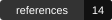
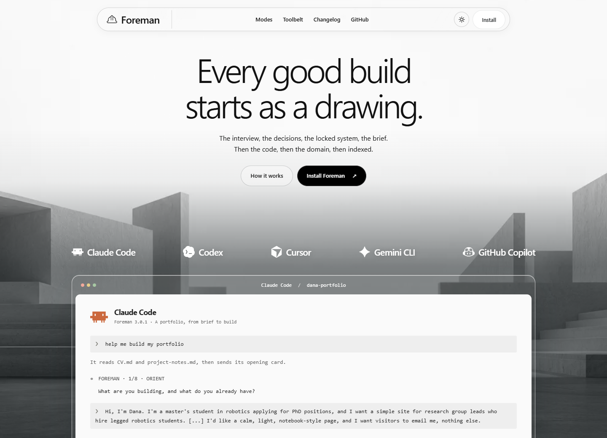
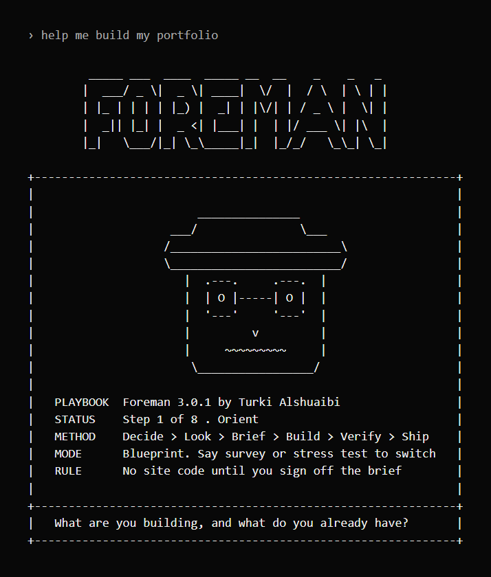

# Foreman

**A build playbook for shipping real websites with coding agents, by Turki Alshuaibi.**
Not tied to any one agent: it is a folder of markdown, so it runs on Claude Code, Cursor, Windsurf, Codex, Copilot, Gemini CLI, or a chat window with no skills support at all.

[](AGENTS.md)
[](https://code.claude.com/docs/en/plugins)
[](#what-is-in-the-box)
[](#three-modes)
[](#the-toolbelt)
[](#what-is-in-the-box)
[](#what-is-in-the-box)
[](CHANGELOG.md)
[](https://github.com/Turki-Sh/Foreman/actions/workflows/validate.yml)
[](#no-scripts)
[](LICENSE)
[](https://turkialshuaibi.com/)
[](https://www.claudepluginhub.com/plugins/turki-sh-foreman-plugins-foreman?ref=badge)

**[foreman.turkialshuaibi.com](https://foreman.turkialshuaibi.com/)**

[Watch the films](https://foreman.turkialshuaibi.com/films/): a one-minute introduction and four focused demonstrations, all with captions in 33 languages.

<p align="center">
  <a href="https://foreman.turkialshuaibi.com/">
    
  </a>
</p>

<p align="center"><i>Foreman’s website, developed with the playbook and refined through owner review.</i></p>

Coding agents removed the cost of writing a site. They did not remove the cost of deciding what it should be. So the internet now has thousands of sites that were built in an afternoon and look like each other: the same cream background, the same serif hero, the same three cards, the same accent, no domain, no metadata, no 404.

Foreman is the missing half. It turns the agent you are already talking to into a foreman: it interviews you, forces the decisions you would have delegated, locks a visual system before any code exists, writes one high-quality build brief, then asks whether to build it there or hand it over, and walks you through verification, DNS, and indexing until the thing is actually live.

You do not read Foreman. Your agent does.

## Install

Foreman is one folder of markdown. Nothing compiles, nothing runs, so it installs anywhere an agent reads files.

**Claude Code.** Both lines, in this order.

```
/plugin marketplace add Turki-Sh/Foreman
/plugin install foreman@alshuaibi
```

If your Claude Code surface does not support `/plugin`, run the same two steps in your shell, then start a new session.

```
claude plugin marketplace add Turki-Sh/Foreman
claude plugin install foreman@alshuaibi
```

Already installed? Refresh the marketplace and update the plugin from your shell:

```
claude plugin marketplace update alshuaibi
claude plugin update foreman@alshuaibi
```

You can also select **Update now** for Foreman in the `/plugin` panel. See [Claude Code’s install and update documentation](https://code.claude.com/docs/en/discover-plugins).

**Claude apps.** Download [`foreman.skill`](https://github.com/Turki-Sh/Foreman/raw/main/dist/foreman.skill) and upload it as a skill. The toolbelt is inside it.

**Cursor, Windsurf, Codex, Copilot, Gemini CLI, Cline, or any other coding agent.** Clone the repo and copy the skill folder where your agent looks for skills or rules. The toolbelt travels inside that folder.

```
git clone https://github.com/Turki-Sh/Foreman.git
cp -r Foreman/plugins/foreman/skills/foreman ~/.agents/skills/
```

Common destinations: `~/.agents/skills/`, `~/.cursor/rules/`, `~/.codex/skills/`, or a `.github/` folder in the project. See [AGENTS.md](AGENTS.md) for per-tool paths and for what to do if your agent has no skills directory at all.

**Any assistant with no skills support, including the web chat you already have open.** Paste [`SKILL.md`](plugins/foreman/skills/foreman/SKILL.md) into the conversation and say "run this on me." The steps work without the references; the references only deepen them.

### Use Foreman with your team (optional)

If Foreman is part of this project's workflow, install it at project scope. Run these commands from the project directory:

```sh
claude plugin marketplace add Turki-Sh/Foreman
claude plugin install foreman@alshuaibi --scope project
```

This records Foreman in `.claude/settings.json`:

```json
{
  "enabledPlugins": {
    "foreman@alshuaibi": true
  }
}
```

Keep any existing settings and other plugin entries. Review the diff, then commit `.claude/settings.json` so collaborators receive the configuration. Each collaborator still runs the two commands above once on their machine; committing settings does not download the plugin for them.

For personal use, keep the default user-scope installation. Project sharing is optional and works in private repositories too. Keep credentials and personal overrides out of the shared file.

[Claude Code installation scopes](https://code.claude.com/docs/en/discover-plugins#choose-an-install-scope) · [Shared settings](https://code.claude.com/docs/en/settings#settings-files-and-who-they-affect)

The [Foreman website](https://foreman.turkialshuaibi.com/) is available in 33 languages. All non-English editions are marked Beta. The playbook and original recorded examples remain in English.

## Usage

Start a build in plain words:

> help me build my portfolio

The agent should answer with the Foreman card and a question, not with code. That is the whole point.

<p align="center">
  
</p>

Choose how deep it goes by saying the word at any point: **survey** for the fewest questions, **stress test** for the most. In Claude Code you can also start in a mode with `/foreman:foreman survey`.

Call a tool on its own, without the interview:

```
/foreman:punch-list https://your-site.com
/foreman:board a portfolio for a robotics researcher, academic
/foreman:palette
/foreman:launch
```

Or just ask: "why does my site look AI-made?", "give me a reference board", "pick me a palette", "my domain will not load". Outside Claude Code, the same words reach the same tools.

## Three modes

A mode changes how many questions Foreman asks and who does the legwork. It never changes which decisions get made.

| Mode | For | Before any code exists |
|---|---|---|
| **Survey** | You want it moving, or you already have most of the material | About four exchanges. The agent reads your repo, your site and your CV, looks at your category, and sends one decision sheet with a source on every line. You correct it |
| **Blueprint** | The default, and most builds | The full interview, one question at a time |
| **Stress test** | A launch where a weak decision is expensive | The full interview, every answer pushed once, a pre-mortem before the brief freezes, and a full punch list before it ships |

Even in Survey, three things stay yours: you pick the palette from variants, the copy comes from your own sentences, and you sign off the brief. Fewer questions never means the agent takes the obvious answer.

## The toolbelt

Four tools that run on their own or in the middle of a session.

| Tool | What it does |
|---|---|
| **[Board](https://foreman.turkialshuaibi.com/board/)** | Real sites chosen for your brief, as a list or a visual board with screenshots, ending in the principles worth taking from them |
| **[Punch list](https://foreman.turkialshuaibi.com/punch-list/)** | Audits any site, including ones Foreman never touched, for what makes it look AI-generated or unfinished, ranked, with a fix for each |
| **[Palette](https://foreman.turkialshuaibi.com/palette/)** | Three palettes from a material you name, contrast checked, on your real content |
| **[Launch](https://foreman.turkialshuaibi.com/launch/)** | Domain, DNS, SSL, the share card, a real 404, the sitemap and indexing, one step at a time |

## What changes

| | Without Foreman | With Foreman |
|---|---|---|
| First move | Generates a page | Asks what the site is for and who reads it |
| Copy | Written by the model | Extracted from you, with numbers |
| Design | Whatever the model defaults to | Locked tokens you chose from three variants |
| Scope | Everything it can think of | Explicit non-goals, written before the build |
| Done | It renders on your laptop | 375px, keyboard, Lighthouse, incognito, real 404 |
| Live | "Deployed" | DNS, SSL, sitemap, Open Graph, submitted and indexed |

## What is in the box

**Session flow.** Eight steps with gates, written for the agent, not for you, at three depths. It does not advance until each gate is met, it stamps which step you are on in every message, and it writes no line of the site until the brief is frozen.

**Four tools** in `toolbelt/`: board, punch list, palette, and launch. In Claude Code each is also a slash command.

**Fourteen references**, loaded only when the step arrives: content interview, design direction, the palette workflow, composition and choreography, the reference library, vibe-coded tells, design standards (colour theory, proportion and the golden ratio, type scale and measure, spacing, gestalt, motion timing, optical correction), stack choice, the build brief, performance and accessibility, metadata and 404, bilingual and RTL, verify and ship, and a full worked example.

**Seven fillable assets:** a brand harness with three variants, a reference board, a head metadata block with Open Graph and JSON-LD, a custom 404, robots.txt, sitemap.xml, and llms.txt.

<a id="no-scripts"></a>
**No executable code in the installed skill.** The plugin ships no scripts, no hooks, no MCP servers, and makes no network calls. The repository separately contains website build scripts and an opt-in benchmark harness. Its four slash commands are markdown skills like the rest of it. You can read every line before you trust it. The one `<script>` tag in the plugin is a `type="application/ld+json"` structured data block inside `assets/head-metadata.html`: inert JSON meant for your site's `<head>`, not code that runs when you install this. CI fails the build if anything executable appears.

**See it run before you install it.** [The worked example](plugins/foreman/skills/foreman/references/worked-example.md) is a full session from the first question to a frozen brief, the same opening in Survey, and the thing that went wrong afterwards.

## The three ideas it enforces

1. **The agent's ceiling is your brief.** Model choice is a rounding error next to the quality of the specification.
2. **Non-goals are the highest-leverage lines you will write.** Agents over-build by default, and one line prevents it.
3. **Decisions are yours, typing is theirs.** Delegate the implementation. Delegating the judgment is what produces the default look.

## Contributing

Contributions are open in some areas and closed in others. [CONTRIBUTING.md](CONTRIBUTING.md) says which.

The most useful thing you can send is a failure the playbook did not intercept: your build broke, and Foreman never asked the question that would have prevented it. Post it on the [meta thread](https://github.com/Turki-Sh/Foreman/issues/1). The most useful pull request is an install path for an agent I cannot test.

Foreman sends nothing anywhere, so it only learns what worked when someone says. A [session report](https://github.com/Turki-Sh/Foreman/issues/new?template=session-report.yml) takes two minutes, good session or bad, and your agent can draft it.

## How it is measured

[`bench/`](bench/README.md) runs real agent sessions against simulated owners, with and without Foreman, and measures the sites in a browser: invented numbers, the default AI palette, dead links, overflow on a phone, contrast, metadata, the 404. Comparative claims require clean runs with the run count, model and date beside them. A full clean scenario benchmark has not been completed for 3.0.1. Local website checks are recorded separately in the [site audit](bench/SITE-AUDIT-2026-10-30.md).

The website includes visual examples for [Board](https://foreman.turkialshuaibi.com/board/), [Punch list](https://foreman.turkialshuaibi.com/punch-list/), [Palette](https://foreman.turkialshuaibi.com/palette/) and [Launch](https://foreman.turkialshuaibi.com/launch/). The [Dana portfolio](https://foreman.turkialshuaibi.com/samples/dana-reference/) is an owner-reviewed example with a fictional research persona, not a controlled benchmark. Its [run documentation](bench/examples/dana-reference-guided/README.md) records the agent, references and artwork provenance.

## Author

Built by **Turki Alshuaibi**, AI engineer. Everything in it came from shipping, and from watching capable engineers get stuck in the same handful of places, which are the failure modes listed at the end of the skill.

[](https://turkialshuaibi.com/)
[](https://linkedin.com/in/turki-alshuaibi)
[](https://github.com/Turki-Sh)
[](mailto:turki@turkialshuaibi.com)

## License

MIT. Use it, fork it, teach with it, ship client work with it.

MIT does require attribution: the copyright notice travels with any copy or substantial portion. Beyond that legal minimum, if Foreman shaped a site you are proud of, a line in your README or a link in the post is the thing that actually helps. Credit costs you nothing and it is how a playbook finds the next person who needs it.
